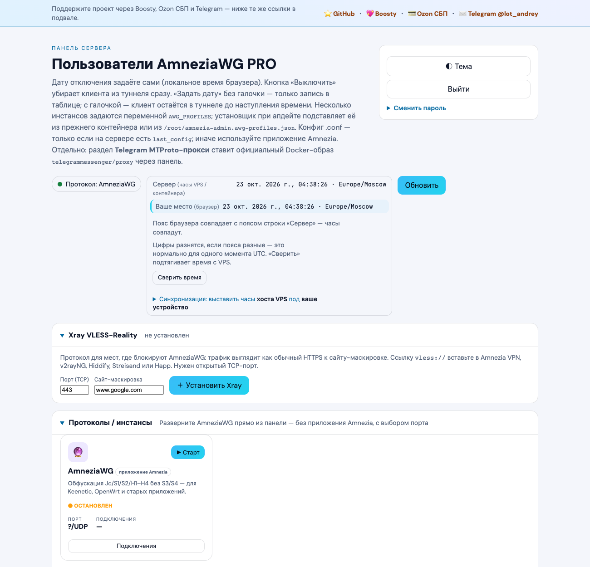
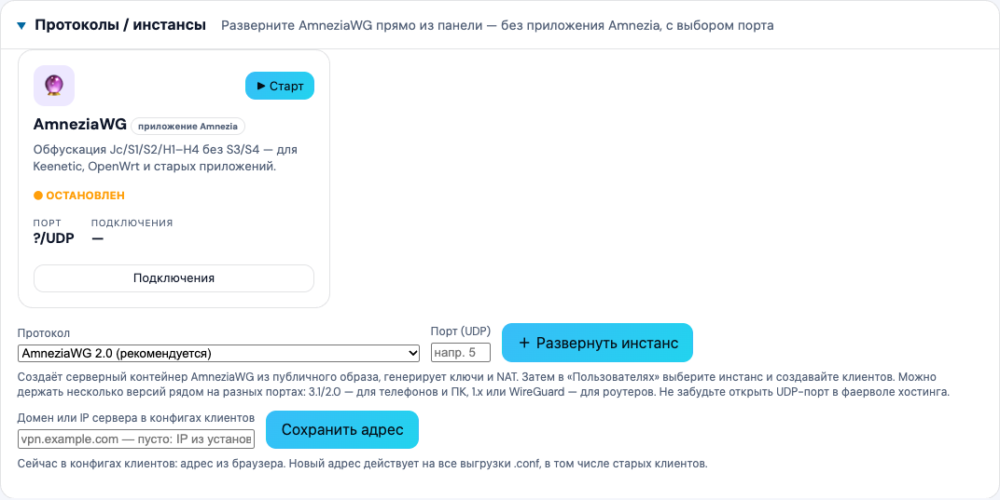

# amnezia_web-PRO

Полностью открытая веб-панель для сервера Amnezia: все функции бесплатны, без платных или закрытых редакций. Один репозиторий, один установщик.





**Что умеет:** клиенты AmneziaWG (создать, выключить, дата отключения, .conf), установка протоколов из браузера (AmneziaWG 1.x/2.0/3.0/3.1, WireGuard), Xray VLESS‑Reality, Cloudflare WARP и каскад через другой сервер, Telegram MTProto‑прокси, домен сервера в конфигах, светлая/тёмная тема.

**Установка** (Ubuntu 22.04/24.04, Debian 12, под root; Docker поставится сам):

```bash
# основной адрес
curl -fsSL https://git.bobyrev.com/PCA/amnezia_web-PRO/raw/branch/main/scripts/install.sh | sudo bash
# запасной — GitHub (если основной недоступен)
curl -fsSL https://raw.githubusercontent.com/andrey271192/amnezia_web-PRO/main/scripts/install.sh | sudo bash
```

Установщик сам качает код с того источника, который отвечает: сначала git.bobyrev.com, потом GitHub.

Панель: `http://IP:8080`, вход — пароль `admin` (смените сразу). Код и выпуски: [git.bobyrev.com/PCA/amnezia_web-PRO](https://git.bobyrev.com/PCA/amnezia_web-PRO) · [выпуски](https://git.bobyrev.com/PCA/amnezia_web-PRO/releases) · копия на [GitHub](https://github.com/andrey271192/amnezia_web-PRO).

## Что нового в 1.4.2

- **Проект переехал на [git.bobyrev.com/PCA/amnezia_web-PRO](https://git.bobyrev.com/PCA/amnezia_web-PRO)** — GitHub-аккаунт заблокирован. Установщик берёт код с того из двух источников (git.bobyrev.com или GitHub), что отвечает.

## Что нового в 1.4.0

- **Xray VLESS‑Reality** — раздел «Xray VLESS‑Reality»: установка с выбором TCP‑порта и сайта‑маскировки, клиенты (создать, выключить/включить, удалить), ссылка `vless://` для Amnezia VPN, v2rayNG, Hiddify, Streisand, Happ. Файлы в `/opt/amnezia/xray` в том же формате, что у приложения Amnezia.
- **Установщик сам ставит Docker** на чистом сервере.
- **Всё открыто:** убрана редакция «community / только просмотр» и переменные `AMNEZIA_EDITION`, `COMMUNITY_UPGRADE_*` — все функции доступны всем.

## Что нового в 1.3.0

- **Установка протоколов прямо с сайта** (раздел «Протоколы / инстансы»), несколько версий рядом на разных портах:
  | Вариант | Для кого |
  |---|---|
  | AmneziaWG 3.1 | новейший: защита заголовков, случайные хвосты; свежее приложение Amnezia |
  | AmneziaWG 3.0 | HeaderProtectionKey, паддинг |
  | AmneziaWG 2.0 | рекомендуемый по умолчанию (S3/S4) |
  | AmneziaWG 1.x | роутеры Keenetic/OpenWrt и старые приложения (без S3/S4) |
  | WireGuard (Legacy) | любой WG-клиент, без обфускации |
- **Исправлено:** конфиг клиента для AWG 1.x получал лишние S3/S4/I1 — рукопожатие было, интернета нет. Теперь в .conf попадают только параметры, которые есть на сервере.
- **Исправлено:** при обновлении установщик записывал контейнеры панели в `AWG_PROFILES`, и переключение инстанса создавало клиента не там.
- **Исправлено:** проверка занятого UDP-порта смотрела внутрь контейнера панели и ничего не находила.
- **Домен сервера** — поле «Домен или IP сервера в конфигах клиентов»: подставляется в Endpoint всех выгрузок, домен проверяется на резолв.
- **Настоящий каскад** — в разделе «Cloudflare WARP / каскад» вставьте клиентский .conf другого сервера: отмеченные клиенты выходят в интернет через него (переживает перезапуск контейнера).
- **Светлая / тёмная тема** — кнопка «◐ Тема» в шапке (по умолчанию как в системе).
- Старые установки не затрагиваются: контейнеры, поставленные приложением Amnezia, остаются как были.

## Быстрый старт: от пустого сервера до VPN за 10 минут

**Что нужно:** VPS с Ubuntu 22.04/24.04 или Debian 12 (1 ГБ ОЗУ хватает), доступ root по SSH. Docker ставить не нужно — установщик поставит его сам.

**1. Установите панель.** Зайдите на сервер по SSH и выполните:

```bash
curl -fsSL https://git.bobyrev.com/PCA/amnezia_web-PRO/raw/branch/main/scripts/install.sh | sudo bash
```

В конце будет строка `Админ-панель: http://IP:8080`.

**2. Откройте порты** в фаерволе хостинга (панель управления VPS) и, если включён, в `ufw`:

| Порт | Зачем |
|---|---|
| `8080/tcp` | админ-панель |
| `80/tcp` | страница для пользователей (необязательно, `SKIP_LANDING=1` — без неё) |
| UDP-порт AmneziaWG, который выберете на шаге 4 (например `41010/udp`) | VPN AmneziaWG |
| TCP-порт Xray, если будете ставить (например `443/tcp`) | VPN Xray |

```bash
sudo ufw allow 8080/tcp && sudo ufw allow 41010/udp   # пример, если ufw включён
```

**3. Войдите** на `http://IP:8080` — пароль **`admin`**. Сразу смените его в блоке «Сменить пароль».

**4. Разверните протокол.** Раздел «Протоколы / инстансы» → выберите вариант → порт (например `41010`) → «Развернуть инстанс». Какой выбрать:
- **AmneziaWG 2.0** — по умолчанию, для телефонов и ПК (приложение Amnezia VPN);
- **AmneziaWG 3.1 / 3.0** — самые новые, нужна свежая версия приложения;
- **AmneziaWG 1.x** — для роутеров Keenetic / OpenWrt;
- **WireGuard** — для любых WG-клиентов, без маскировки.

Если на сервере уже стоит VPN, поставленный приложением Amnezia, — шаг пропустите: панель найдёт его сама.

**5. Создайте клиента.** Блок «Новый клиент» → имя → «Создать и скачать .conf». Файл импортируйте в Amnezia VPN (на телефоне/ПК: «+» → «Файл с настройками»).

**6. (по желанию) Xray VLESS‑Reality** — если AmneziaWG у провайдера режут. Раздел «Xray VLESS‑Reality» → порт TCP (`443`, если свободен) и сайт‑маскировка → «Установить Xray» (~1 минута) → «Создать» клиента — ссылка `vless://` скопируется. Вставьте её в Amnezia VPN, v2rayNG, Hiddify, Streisand или Happ («+» → «Из буфера обмена»).

**7. Свой домен (по желанию).** В «Протоколы / инстансы» → «Домен или IP сервера в конфигах клиентов» → «Сохранить адрес». Без него в конфиги подставляется IP.

**Обновление** — та же команда из шага 1: клиенты, пароль и настройки сохраняются. **Удаление** — см. «Удаление одной командой».

**Если не работает:**
- «Рукопожатие есть, интернета нет» или нет рукопожатия — не открыт UDP-порт у хостинга (шаг 2).
- Панель не открывается — не открыт `8080/tcp`; проверка на сервере: `curl -s localhost:8080/health`.
- Xray: «TCP-порт занят» — выберите другой порт (например `8443`) и откройте его.
- Логи панели: `sudo docker logs --tail 50 amnezia-admin`.

## Что открывается по какому порту

| Адрес | Назначение |
|-------|------------|
| **`http://IP:HOST_PORT`** (по умолчанию **`:8080`**) | **Админ-панель:** клиенты AmneziaWG, опциональные блоки **Telegram MTProto‑прокси** и **Cloudflare WARP**, каскад, экспорт `.conf`, смена пароля. Внизу страницы — футер со ссылками автора (GitHub, донат, Telegram и т.д.). |
| **`http://IP:LANDING_PORT`** (по умолчанию **`:80`**) | **Публичная страница** для приглашённых: инструкция, кнопка перехода в админку (`landing/admin-port.js` подставляет тот же `HOST_PORT`). Текст «проблемы — администратору сервера» и дисклеймер. **Без** блока доната и личных ссылок автора — они только в админке. |

Если порт **80** занят другим сервисом, задайте **`LANDING_PORT`** (например `8081`) или **`SKIP_LANDING=1`**. На работу панели по **`HOST_PORT`** это не влияет.

## Скриншоты

<p align="center">

<br/><br/>

</p>

Файлы: `docs/screenshots/panel-users-table.png`, `docs/screenshots/panel-overview-password.png` — замените на свои живые PNG при необходимости.

---

## Установка

### Public install from GitHub

```bash
curl -fsSL https://git.bobyrev.com/PCA/amnezia_web-PRO/raw/branch/main/scripts/install.sh | sudo bash
```

Панель после установки открывается по **`http://IP:HOST_PORT`** (по умолчанию `:8080`). Первый вход: **логин `admin`, пароль `admin`**. Смените пароль сразу после входа.

### Обновить/переустановить панель с GitHub

Если `/opt/amnezia-admin` не git-репозиторий, это нормально: установщик скачивает свежий архив с GitHub, делает backup старой папки, сохраняет текущий порт и текущий Docker volume `/data`, затем пересобирает только контейнер панели **`amnezia-admin`**. Контейнеры AmneziaWG (`amnezia-awg`, `amnezia-awg2` и т.д.) не удаляются и не пересоздаются.

```bash
curl -fsSL https://git.bobyrev.com/PCA/amnezia_web-PRO/raw/branch/main/scripts/install.sh | sudo bash
```

Если не нужен лендинг на порту 80:

```bash
curl -fsSL https://git.bobyrev.com/PCA/amnezia_web-PRO/raw/branch/main/scripts/install.sh | sudo env SKIP_LANDING=1 bash
```

### Переменные окружения и `sudo`

Частая ошибка: задали **`AWG_PROFILES`**, **`ADMIN_PASSWORD`** или другую переменную из таблицы «в одной строке» перед `curl`, а затем выполнили **`curl … | sudo bash`**. По умолчанию **`sudo` не передаёт** это окружение в `bash`, который читает установочный скрипт с stdin: установщик **не увидит** переменные, переключатель **«Инстанс»** не появится.

**Надёжные варианты:**

1. **`sudo -E bash`** вместо `sudo bash` (для большинства VPS достаточно):

```bash
AWG_PROFILES='[{"id":"awg",…}]' curl -fsSL https://git.bobyrev.com/PCA/amnezia_web-PRO/raw/branch/main/scripts/install.sh | sudo -E bash
```

2. **Файл на VPS** (способ без `-E`): записать JSON **одной строкой** в **`/root/amnezia-admin.awg-profiles.json`** (например `umask 077; printf '%s\n' '[{"id":"awg",…}]' > /root/amnezia-admin.awg-profiles.json`), затем обычный **`curl … | sudo bash`** — установщик подставит профили из файла (см. абзац про снимок ниже таблицы).

3. Установка под **`root`** без `sudo`: **`curl … | bash`** — переменные текущей оболочки доходят до скрипта.

**Не используйте** конструкции вроде **`curl … | bash -c "sudo -E bash"`**: stdin установочного скрипта должен попасть **напрямую** в тот `bash`, который его выполняет.

**Безопасность:** не публикуйте пароли от VPS, ключи и дампы `clientsTable` в Issues, чатах и скриншотах — это полный компромисс сервера.


Другой репозиторий или ветка:

```bash
GITHUB_REPO=ваш/форк BRANCH=main curl -fsSL https://raw.githubusercontent.com/ваш/форк/main/scripts/install.sh | sudo bash
```

Уже скачали проект вручную в `/opt/amnezia-admin`:

```bash
cd /opt/amnezia-admin && chmod +x scripts/install.sh && sudo SKIP_DOWNLOAD=1 bash scripts/install.sh
```

Переменные установки (необязательно):

| Переменная | По умолчанию | Назначение |
|------------|--------------|------------|
| `GITHUB_REPO` | `PCA/amnezia_web-PRO` | Откуда качать архив |
| `BRANCH` | `main` | Ветка |
| `INSTALL_DIR` | `/opt/amnezia-admin` | Куда распаковать исходники |
| `DATA_DIR` | `/opt/amnezia-admin-data` | Том с `password.hash` и сессией |
| `HOST_PORT` | `8080` | Порт HTTP панели на хосте |
| `AWG_CONTAINER` | `amnezia-awg` | Имя контейнера Amnezia WG |
| `AWG_PROFILES` | auto | JSON-массив профилей: несколько контейнеров/путей (см. ниже). Если не задан и на VPS уже есть несколько контейнеров `amnezia-awg*`, установщик сам соберёт профили и сохранит их в `/root/amnezia-admin.awg-profiles.json`. Если задан вручную — переключатель «Инстанс» в вебе. При однострочной установке с переменной в окружении нужен **`sudo -E bash`** или файл **`/root/amnezia-admin.awg-profiles.json`** — см. раздел **«Переменные окружения и sudo»** выше. В каждом объекте можно задать `warpDir`, `warpConf`, `warpClientsList`, `startScript` — см. раздел **Cloudflare WARP** |
| `WARP_DIR` | `/opt/warp` | В контейнере AWG: каталог для `warp.conf` и `clients.list` |
| `WARP_CONF_PATH` | `{WARP_DIR}/warp.conf` | Нестандартный путь к конфигу WARP |
| `WARP_CLIENTS_LIST` | `{WARP_DIR}/clients.list` | Список строк `10.8.x.x/32` — кому маршрутизировать трафик через интерфейс `warp` |
| `AMNEZIA_START_SCRIPT` | `/opt/amnezia/start.sh` | Куда встраивается блок автоподъёма WARP после перезапуска (маркеры совместимы с прежним `warp-manager`) |
| `WARP_SSH_INSTALL_DIR` | `/opt/amnezia-admin` | Каталог на **хосте VPS**, откуда по SSH выполняется `scripts/warp-amnezia.sh` при установке/удалении WARP из панели (`POST /api/warp/host-setup`) |
| `SCHEDULE_DISCONNECT_MS` | `60000` | Как часто планировщик проверяет отложенное отключение из туннеля (мс) |
| `TZ` | _(часто UTC в Docker)_ | Пояс строки «Сервер» в панели (IANA, например `Europe/Berlin`). Без `TZ` берётся из образа (часто UTC) — тогда от браузера будет видна разница часов |
| `TIME_SYNC_SSH_HOST` | `172.17.0.1` | Хост для SSH root при синхронизации времени из панели (часто шлюз Docker к хосту) |
| `TIME_SYNC_DISABLED` | `0` | `1` — скрыть/отключить синхронизацию времени по SSH |
| `CLIENT_CONFIG_ENDPOINT` | _(нет)_ | Публичный IP или DNS VPS для строки `Endpoint` при сборке `.conf` из `last_config`, если нет `hostName` в JSON и заходите в панель не по IP |
| `CLIENT_EXPORT_DNS1` | `8.8.8.8` | DNS в экспортируемом клиентском конфиге |
| `CLIENT_EXPORT_DNS2` | `8.8.4.4` | Второй DNS в экспортируемом конфиге |
| `EXPORT_CONFIG_SECRET` | _(нет)_ | Секрет для прямой ссылки без входа в панель: `GET /api/clients/export-config?token=СЕКРЕТ&clientId=…&profileId=…` (при нескольких инстансах `profileId` обязателен). Не светите URL посторонним |
| `ADMIN_PASSWORD` | _(генерируется)_ | Первый пароль вместо файла |
| `SKIP_DOWNLOAD` | `0` | `1` — не качать GitHub, собрать из `INSTALL_DIR` |
| `SKIP_LANDING` | `0` | `1` — не поднимать nginx-лендинг на `LANDING_PORT` |
| `LANDING_PORT` | `80` | Порт nginx-лендинга (если `80` занят — например `8081`) |
| `LANDING_CONTAINER` | `amnezia-web-landing` | Имя контейнера лендинга |
| `NO_CACHE` | `0` | `1` — `docker build --no-cache` при проблемах с обновлением образа |
| `UI_HIDE_SECTIONS` | _(нет)_ | Список через запятую: **`users`**, **`warp`**, **`cascade`**, **`mtproto`** — скрыть блоки в веб-панели (см. ниже). При обновлении через `install.sh` значение подтягивается из старого контейнера, если не задано заново |
| `UI_HIDE_USERS` | `0` | `1` или `true` — эквивалент `users` в `UI_HIDE_SECTIONS` |
| `UI_HIDE_WARP` | `0` | `1` — эквивалент `warp` (также блокируются `POST /api/warp/*`) |
| `UI_HIDE_CASCADE` | `0` | `1` — эквивалент `cascade` (блокируется `POST /api/clients/create-cascade`) |
| `UI_HIDE_MTPROTO` | `0` | `1` или **`mtproto`** в `UI_HIDE_SECTIONS` — скрыть блок установки MTProto; **`GET/POST /api/mtproto/*`** отвечают **403** |
| `MTPRO_PROXY_CONTAINER` | `mtproto-proxy` | Имя контейнера MTProto (образ **telegrammessenger/proxy**) |
| `MTPRO_PROXY_IMAGE` | `telegrammessenger/proxy:latest` | Образ **`docker pull`** при установке из панели |
| `MTPRO_INTERNAL_PORT` | `443` | Порт процесса **внутри** контейнера прокси |
| `MTPRO_PUBLISH_PORT` | `8443` | Порт **хоста**, проброшенный наружу (`-p`) |
| `MTPRO_PUBLISH_BIND` | `0.0.0.0` | Адрес bind на хосте для `-p` |
| `MTPRO_PUBLIC_HOST` | _(нет)_ | Публичный IP/DNS для ссылки **`tg://proxy`**; можно вместо этого задать **`CLIENT_CONFIG_ENDPOINT`** |

Переменная **`AWG_PROFILES`** при установке автоматически сохраняется в **`/root/amnezia-admin.awg-profiles.json`** на VPS; при следующем запуске `install.sh` без `AWG_PROFILES` значение подставляется из этого файла или из **старого контейнера** `amnezia-admin` перед его удалением — так переключатель «Инстанс» не пропадает после обновления панели. Если файла и переменной нет, но на VPS запущено несколько контейнеров **`amnezia-awg*`**, установщик сам создаёт профили по контейнерам.

#### Несколько инстансов (AmneziaWG + Legacy и т.д.)

Пути и имена контейнеров на сервере могут отличаться — проверьте внутри контейнера (`docker exec … ls /opt/amnezia`). Установщик сохраняет JSON в **`/root/amnezia-admin.awg-profiles.json`** и при следующем запуске подставляет его, если вы не передали `AWG_PROFILES`.

**Пример 1** — классическая схема: основной AWG в `amnezia-awg`, Legacy в отдельном контейнере с каталогом `wireguard`:

```bash
AWG_PROFILES='[{"id":"awg","label":"AmneziaWG","container":"amnezia-awg","confPath":"/opt/amnezia/awg/awg0.conf","clientsPath":"/opt/amnezia/awg/clientsTable","iface":"awg0","wgBinary":"awg","pskPath":"/opt/amnezia/awg/wireguard_psk.key"},{"id":"legacy","label":"AmneziaWG Legacy","container":"amnezia-wg0","confPath":"/opt/amnezia/wireguard/wg0.conf","clientsPath":"/opt/amnezia/wireguard/clientsTable","iface":"wg0","wgBinary":"wg","pskPath":"/opt/amnezia/wireguard/wireguard_psk.key"}]' \
curl -fsSL https://git.bobyrev.com/PCA/amnezia_web-PRO/raw/branch/main/scripts/install.sh | sudo -E bash
```

**Пример 2** — оба конфигурационных набора внутри контейнера **`amnezia-awg`** (файл `wg0.conf` рядом с `awg0.conf` в `/opt/amnezia/awg/`):

```bash
AWG_PROFILES='[{"id":"awg","label":"AmneziaWG","container":"amnezia-awg","confPath":"/opt/amnezia/awg/awg0.conf","clientsPath":"/opt/amnezia/awg/clientsTable","iface":"awg0","wgBinary":"awg","pskPath":"/opt/amnezia/awg/wireguard_psk.key"},{"id":"legacy","label":"AmneziaWG Legacy","container":"amnezia-awg","confPath":"/opt/amnezia/awg/wg0.conf","clientsPath":"/opt/amnezia/awg/clientsTable","iface":"wg0","wgBinary":"wg","pskPath":"/opt/amnezia/awg/wireguard_psk.key"}]' \
curl -fsSL https://git.bobyrev.com/PCA/amnezia_web-PRO/raw/branch/main/scripts/install.sh | sudo -E bash
```

Для **Legacy** часто используется обычный `wg`, для новой AmneziaWG — **`awg`**; поле **`pskPath`** желательно указывать явно, если путь к `wireguard_psk.key` нестандартный.

Если в вебе пропал список **«Инстанс»**, смотрите раздел «Если пропал список Инстанс» в **[docs/panel-guide.md](docs/panel-guide.md)**.

Если на хосте уже запущено **несколько** контейнеров с именами вида **`amnezia-awg*`**, а в панели по-прежнему один инстанс — перезапустите установщик из GitHub. Он автоматически создаст **`AWG_PROFILES`** и сохранит файл **`/root/amnezia-admin.awg-profiles.json`**. Ручной JSON нужен только при нестандартных путях внутри контейнеров.

### Импорт клиента из Amnezia backup / `.conf`

В панели есть блок **«Импорт клиента»**. Он нужен, когда клиент уже создан в приложении Amnezia, но в веб-панели его нет или у строки нет `last_config`.

Что поддерживается:

- вставка готового клиентского **`.conf`** с секциями `[Interface]` и `[Peer]`;
- вставка JSON backup, если внутри него есть строка с таким `.conf`;
- восстановление записи в **`clientsTable`** без дублирования peer, если peer уже есть в `awg0.conf`;
- добавление peer в текущий инстанс, если его ещё нет на сервере;
- сохранение исходного `.conf` в `userData.last_config`, чтобы дальше работали экспорт и управление из веба.

Перед импортом выберите нужный **«Инстанс»** вверху панели. Если backup приложения зашифрован или не содержит текстовый `.conf`, сначала экспортируйте клиентский конфиг из приложения Amnezia и вставьте его в форму импорта.

### Telegram MTProto‑прокси

**Не связано с AmneziaWG.** Отдельный контейнер образа **[telegrammessenger/proxy](https://hub.docker.com/r/telegrammessenger/proxy)** на том же хосте. После входа в панель: установка, перезапуск, удаление, выбор порта на хосте, просмотр логов и ссылки **`tg://proxy`** (хост из **`MTPRO_PUBLIC_HOST`**, **`CLIENT_CONFIG_ENDPOINT`** или из URL страницы панели).

- **`GET /api/mtproto/status`** — состояние и ссылка; **`?withLogs=1`** добавляет хвост логов (**`logsFetched`**).
- **`GET /api/mtproto/logs`** и **`GET /api/mtproto/tail`** — хвост **`docker logs`** (отдельный путь **`/tail`**, если прокси обрезает путь **`…/logs`**).
- **`POST /api/mtproto/install`** | **`…/restart`** | **`…/remove`**

За nginx/Caddy нужно проксировать **весь** префикс **`/api/`** на процесс панели. После сборки образа можно свериться: **`GET /health`** отдаёт **`version`** из `package.json`.

Чтобы **скрыть** блок и отключить API: **`UI_HIDE_MTPROTO=1`** или токен **`mtproto`** в **`UI_HIDE_SECTIONS`**.

### Cloudflare WARP (необязательно)

**Устанавливать не обязательно.** Панель и обычный AmneziaWG работают без WARP. Статус **«Не установлен»** значит: в контейнере AWG ещё **нет** `warp.conf` (скрипт на VPS не запускали) — это не ошибка.

Раздел **Cloudflare WARP** в веб-интерфейсе нужен только если вы хотите, чтобы **выбранные** клиенты (с IPv4 `10.8.x.x/32` в AllowedIPs) выходили в интернет через туннель Cloudflare внутри контейнера AWG.

- **Не нужен WARP** — ничего на хосте не запускайте. В панели будет статус **«Не установлен»** — это нормально, блок можно не трогать.
- **Нужен WARP** — в панели кнопка **«Установить WARP на VPS»** (пароль root по SSH, как у синхронизации времени хоста; нужны `sshpass` в образе панели и не отключённый `TIME_SYNC_DISABLED`) **или** один раз на хосте VPS (root), из каталога репозитория (часто `/opt/amnezia-admin`):

```bash
cd /opt/amnezia-admin
chmod +x scripts/warp-amnezia.sh
# при необходимости: AWG_CONTAINER=имя_контейнера
./scripts/warp-amnezia.sh install
```

Скрипт регистрирует туннель через [wgcf](https://github.com/ViRb3/wgcf), создаёт `warp.conf` в контейнере (`/opt/warp` по умолчанию). Дальше в панели отмечаете клиентов и жмёте **«Применить маршрутизацию»** (контейнер AWG перезапустится).

#### Бесплатный WARP и платные продукты Cloudflare

**wgcf** использует тот же по сути **бесплатный** потребительский туннель WARP, что и мобильное приложение Cloudflare WARP. Отдельные **платные** корпоративные сервисы Cloudflare (Zero Trust / Teams и т.п.) — другая модель: политики, доступ и способ выдачи конфигурации. **Подключить «платный тариф» этой панели одной кнопкой нельзя** — нужен WireGuard-совместимый профиль от вашего договора с Cloudflare и ручная подстановка (замена `warp.conf` и маршрутов), это не входит в автоматический установщик.

Подкоманды: `install`, `start`, `stop`, `status`, `rekey`, **`uninstall`**. Учёт wgcf на хосте: `/root/wgcf-account.toml` (и бинарник `/root/wgcf`, если скачан).

**Полностью убрать WARP** — кнопка **«Удалить WARP с VPS»** в веб-панели (SSH с паролем root, как при установке) **или** на хосте вручную (интерфейс `warp`, правила маршрутизации/NAT, блок `# --- WARP-MANAGER ---` в `start.sh`, `warp.conf` и список клиентов в каталоге WARP в контейнере; затем перезапуск контейнера AWG):

```bash
cd /opt/amnezia-admin
./scripts/warp-amnezia.sh uninstall
# нестандартный путь к start.sh в контейнере: AMNEZIA_START_SCRIPT=/путь ./scripts/warp-amnezia.sh uninstall
```

Файлы **wgcf** на хосте (`/root/wgcf-account.toml`, `/root/wgcf-profile.conf`, бинарник `wgcf`) скрипт **не** удаляет — при желании удалите вручную.

Маркеры в `start.sh` (`# --- WARP-MANAGER BEGIN ---`) совместимы с прежним `warp-manager`, если вы уже использовали его.

Необязательно задавать в контейнере **amnezia-admin** переменные `WARP_DIR`, `WARP_CONF_PATH`, `WARP_CLIENTS_LIST`, `AMNEZIA_START_SCRIPT` через установщик — см. таблицу выше.

### Скрытие разделов в панели (`UI_HIDE_*`)

Чтобы упростить интерфейс, можно **не показывать** отдельные блоки:

| Токен в `UI_HIDE_SECTIONS` | Что скрывается |
|---------------------------|----------------|
| `users` | Секция **«Пользователи»** (таблица) и отладочный вывод **awg show**. Запрос **`GET /api/clients`** по-прежнему нужен странице — API для вкл/выкл peer и экспорта **не отключается**, скрыта только таблица. |
| `warp` | Блок **Cloudflare WARP**; запросы **`POST /api/warp/*`** отвечают **403**. |
| `cascade` | Блок **«Новый клиент под каскад»**; **`POST /api/clients/create-cascade`** отвечает **403**. |
| `mtproto` | Блок **«Telegram MTProto‑прокси»**; **`GET`/`POST /api/mtproto/*`** отвечают **403**. |

Пример установки / обновления с частично пустой панелью:

```bash
UI_HIDE_SECTIONS=warp,cascade curl -fsSL https://git.bobyrev.com/PCA/amnezia_web-PRO/raw/branch/main/scripts/install.sh | sudo -E bash
```

Отдельные флаги **`UI_HIDE_USERS`**, **`UI_HIDE_WARP`**, **`UI_HIDE_CASCADE`**, **`UI_HIDE_MTPROTO`** (`1` или `true`) дублируют соответствующий токен.

Итоговые URL после установки совпадают с таблицей **«Что открывается по какому порту»** в начале этого файла; установщик записывает выбранный `HOST_PORT` в **`landing/admin-port.js`**, чтобы кнопка на лендинге вела на нужную админку.

### Каскад (свой Endpoint для клиента)

Сценарий: **устройство в интернете подключается не к вашему «основному» VPS напрямую**, а к **промежуточному узлу** (ещё один VPS, домашний роутер с пробросом и т.д.), а уже этот узел **пересылает UDP** на порт WireGuard вашего основного VPS, где живёт AmneziaWG и эта панель.

Что нужно человеку, который ставит связку:

1. На **этом** (основном) VPS — обычный AmneziaWG и эта панель; здесь блок **«Новый клиент под каскад»** **создаёт peer и ключи** и выдаёт скачанный **`.conf`**, в котором **Endpoint** уже указывает на промежуточную машину.
2. На **промежуточном** сервере нужен **проброс порта DNAT до основного VPS** на тот же **ListenPort**, что слушает туннель здесь (либо свой внешний порт → тогда его указывают в форме как «Порт Endpoint»).

Готовая панель для правил проброса (iptables DNAT NAT «под ключ»): репозиторий **[andrey271192/kaskad_web_vpn](https://github.com/andrey271192/kaskad_web_vpn)** — установка `curl … install.sh | sudo bash`, затем вход в браузере на промежуточный VPS по порту из README (например `8088/setup`) и настройка правила «вход → IP основного VPS:порт WG». Подробные шаги и переменные среды см. там же в README.

### Экспорт конфигурации клиента (.conf)

Если в записи клиента на сервере есть **`userData.last_config`** (JSON из приложения Amnezia с полем **`config`** — готовый текст — или с **`client_priv_key`** и ключами сервера), в таблице появятся **«Скачать .conf»**, **«Прямая ссылка»** и **«Копировать URL»**. Прямая ссылка имеет вид  
`/api/clients/export-config?clientId=…&profileId=…` — последний параметр нужен только при нескольких инстансах (`AWG_PROFILES`). Работает в браузере, где вы уже вошли в панель (cookie-сессия).

Чтобы скачивать **без входа в панель**, задайте **`EXPORT_CONFIG_SECRET`** при установке и открывайте  
`/api/clients/export-config?token=ВАШ_СЕКРЕТ&clientId=…` — при **нескольких** профилях добавьте **`&profileId=…`**. Не пересылайте такую ссылку третьим лицам.

Если на VPS только «голый» `clientsTable` без `last_config`, готового экспорта по старым строкам не будет — используйте блок **«Новый клиент под каскад»** или приложение Amnezia на устройстве.

Для корректного **`Endpoint`** задайте **`CLIENT_CONFIG_ENDPOINT`** при установке (публичный IP или домен VPS), либо убедитесь, что в `last_config` указан **`hostName`**, либо открывайте панель по тому же хосту, который клиенты должны использовать для подключения (не `localhost`).

Имя скачиваемого файла в заголовке **`Content-Disposition`** составляется только из **ASCII** (латиница, цифры, `.`, `_`, `-`). Если имя клиента в приложении на кириллице или с другими символами, в имени файла используется безопасный фрагмент (например префикс `clientId`), чтобы ответ не падал с ошибкой заголовка в Node.js.

### Обновление до новой версии

Коммиты на GitHub **сами не попадают** в уже запущенный контейнер: нужно заново **скачать код и пересобрать образ** (`amnezia-admin` и, если не отключали лендинг, **`amnezia-web-landing`**).

Проще всего для пути из исходников — та же команда, что при установке (данные в `DATA_DIR`, пароль и `AWG_PROFILES` сохранятся — профили подтягиваются из файла на VPS или из старого контейнера). Скрипт **подставит прежний внешний порт** контейнера `amnezia-admin`, если вы не передавали `HOST_PORT` и в коде по умолчанию стоит `8080`:

```bash
curl -fsSL https://git.bobyrev.com/PCA/amnezia_web-PRO/raw/branch/main/scripts/install.sh | sudo bash
```

Если интерфейс после этого всё ещё старый — принудительно без кэша слоёв Docker:

```bash
curl -fsSL https://git.bobyrev.com/PCA/amnezia_web-PRO/raw/branch/main/scripts/install.sh | sudo NO_CACHE=1 bash
```

Если проект уже лежит в `/opt/amnezia-admin` через git и вы подтянули изменения (`git pull`), пересоберите без повторной загрузки архива:

```bash
cd /opt/amnezia-admin && chmod +x scripts/install.sh && sudo SKIP_DOWNLOAD=1 bash scripts/install.sh
```

Порт при этом возьмётся из уже работающего контейнера так же, как при установке с GitHub.

Подставьте **`HOST_PORT=ваш_порт`** перед `bash`, если нужно явно зафиксировать порт (в том числе сменить его при обновлении).

После обновления сделайте в браузере **жёсткое обновление** страницы (Ctrl+Shift+R / ⌘+Shift+R), если интерфейс всё ещё старый.

Команда на сервере для проверки, что в образ попали актуальные статические файлы:

```bash
sudo docker run --rm amnezia-admin:latest grep -Eo 'Новый клиент под каскад|Cloudflare WARP' /app/public/index.html | head -1
```

---

## Удаление одной командой

```bash
curl -fsSL https://git.bobyrev.com/PCA/amnezia_web-PRO/raw/branch/main/scripts/uninstall.sh | sudo bash
```

Полная очистка (контейнер, образ, данные панели и каталог `/opt/amnezia-admin`):

```bash
curl -fsSL https://git.bobyrev.com/PCA/amnezia_web-PRO/raw/branch/main/scripts/uninstall.sh | sudo REMOVE_IMAGE=1 REMOVE_DATA=1 REMOVE_SRC=1 bash
```

---

## Первый вход и пароль

### Режим по умолчанию

На пустой установке создаётся первый вход:

- логин: **`admin`**
- пароль: **`admin`**

Смените пароль сразу после входа в блоке **«Сменить пароль»**.

### Свой пароль при установке

```bash
ADMIN_PASSWORD='ВашНадёжныйПароль' curl -fsSL https://git.bobyrev.com/PCA/amnezia_web-PRO/raw/branch/main/scripts/install.sh | sudo -E bash
```

После первого успешного старта переменную `ADMIN_PASSWORD` из команды `docker run` убирайте — пароль уже в томе `DATA_DIR`.

### Ручной Docker без скрипта

Нужен том `-v /путь/данных:/data`.

Если `password.hash` ещё нет, контейнер создаст `admin/admin`. Для своего первого пароля передайте `-e ADMIN_PASSWORD=...`. Для продвинутого сценария можно заранее положить готовый `password.hash` в том.

---

## Разработка и локальный запуск

```bash
npm install
ADMIN_PASSWORD=localtest node server.js
```

Нужны Docker и контейнер Amnezia на той же машине (или проброс `DOCKER_HOST`).

---

## Support links

Эти ссылки дублируют блок в **футере админ-панели** (`:8080`). На публичном лендинге **`:80`** этого блока нет — там только напоминание написать администратору сервера.

Поддержать проект — поставь звезду на GitHub **И донат**. Связаться с автором — Telegram.

| Способ | Ссылка |
|--------|--------|
| GitHub | [amnezia_web-PRO](https://git.bobyrev.com/PCA/amnezia_web-PRO) |
| Boosty | [boosty.to/andrey27/donate](https://boosty.to/andrey27/donate) |
| Ozon СБП | [Ozon СБП](https://finance.ozon.ru/apps/sbp/ozonbankpay/019dc200-2a5d-7931-a619-782d285f6798) |
| Telegram | [@lot_andrey](https://t.me/lot_andrey) |

Ссылки совпадают с блоком в репозитории [domen_hydra](https://github.com/andrey271192/domen_hydra) (Boosty / Ozon); в интерфейсе они видны **только в админке**, не на лендинге `:80`.

Файл [`.github/FUNDING.yml`](.github/FUNDING.yml) задаёт кнопку **Sponsor** на GitHub.

Блок с донатом и ссылками на автора — **только в футере админ-панели**; лендинг на **`http://сервер:80/`** его не показывает.

---

## Лицензия

MIT, см. [LICENSE](LICENSE).

---

## Поддержка проекта

---

- ⭐ **GitHub:** [PCA/amnezia_web-PRO](https://git.bobyrev.com/PCA/amnezia_web-PRO)
- 💖 **Boosty:** [boosty.to/andrey27/donate](https://boosty.to/andrey27/donate)
- 💳 **Ozon Bank (СБП):** [ссылка](https://finance.ozon.ru/apps/sbp/ozonbankpay/019dc200-2a5d-7931-a619-782d285f6798)
- ✉️ **Telegram:** [@lot_andrey](https://t.me/lot_andrey)
